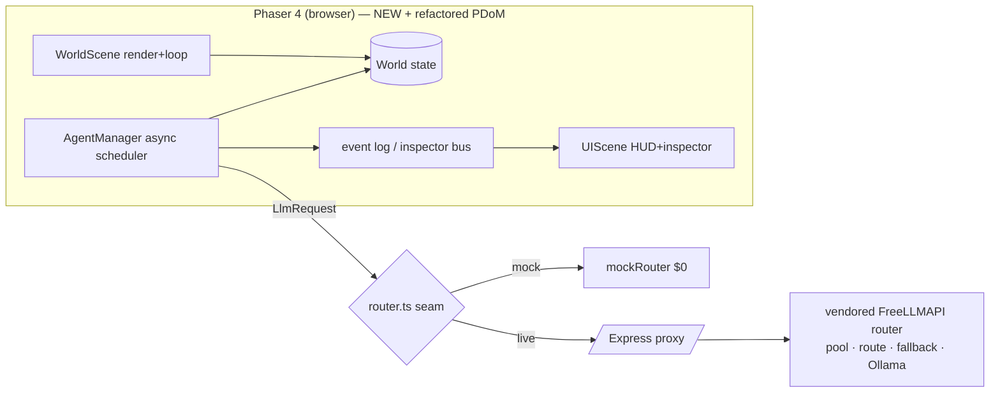

Imported from `docs/deep-research-v1.md:112` by Andon (import docs/deep-research-v1.md:112 d0b81eba3ee2263d); the original stays there.

**Three seams where borrowed code plugs in:**

1. **`Router`** (§11) — FreeLLMAPI conforms to this; client never imports it directly.

2. **`AgentRuntime`/scheduler** (§6) — refactored PDoM pipeline conforms to the async scheduler API.

3. **`Inspector` data model** (§9) — refactored PDoM observability feeds the Phaser HUD.

New code consumes these seams; borrowed code is shaped *to* them.
